<picture><source media="(max-width: 700px)" srcset="./assets/m-title.svg" width="100%"></picture><a href="https://jeremydarko.me"><picture><source media="(max-width: 700px)" srcset="./assets/m-site.svg" width="26%"></picture></a><a href="https://mira-vision.vercel.app"><picture><source media="(max-width: 700px)" srcset="./assets/m-mira.svg" width="24%"></picture></a><a href="https://poorup.tech"><picture><source media="(max-width: 700px)" srcset="./assets/m-poorup.svg" width="25%"></picture></a><a href="https://github.com/jeremy341/egg"><picture><source media="(max-width: 700px)" srcset="./assets/m-egg.svg" width="25%"></picture></a><picture><source media="(max-width: 700px)" srcset="./assets/m-blank.svg" width="0"></picture> <a href="https://jeremydarko.me"><picture><source media="(max-width: 700px)" srcset="./assets/m-portfolio.svg" width="36%"></picture></a><a href="mailto:jeremyyeboahdarko@gmail.com"><picture><source media="(max-width: 700px)" srcset="./assets/m-contact.svg" width="31%"></picture></a><a href="https://github.com/jeremy341?tab=repositories"><picture><source media="(max-width: 700px)" srcset="./assets/m-work.svg" width="33%"></picture></a><picture><source media="(max-width: 700px)" srcset="./assets/m-blank.svg" width="0"></picture><a href="https://github.com/jeremy341/egg"><picture><source media="(max-width: 700px)" srcset="./assets/m-blank.svg" width="0"></picture></a><picture><source media="(max-width: 700px)" srcset="./assets/m-blank.svg" width="0"></picture>

